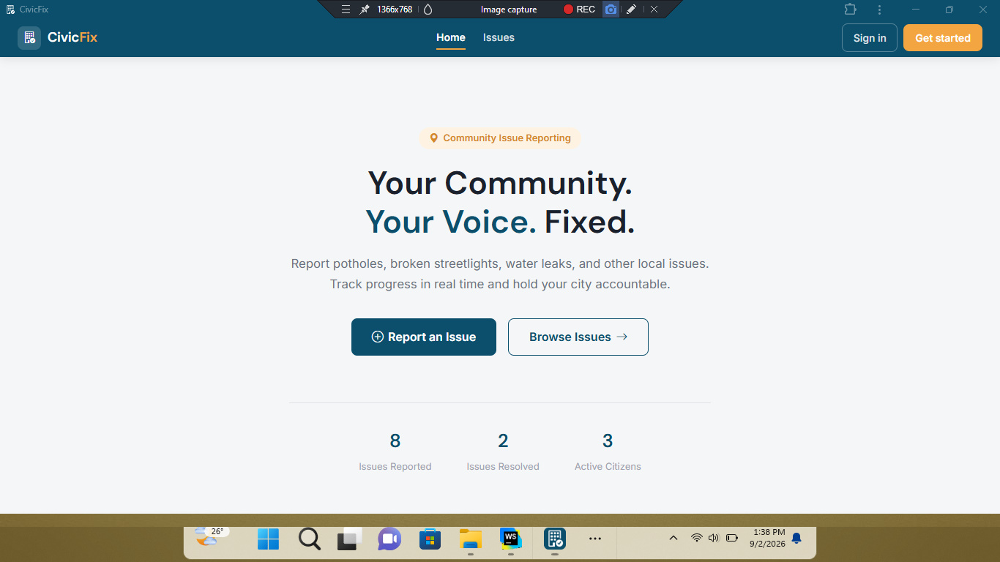
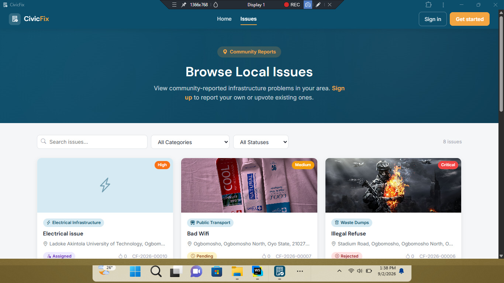
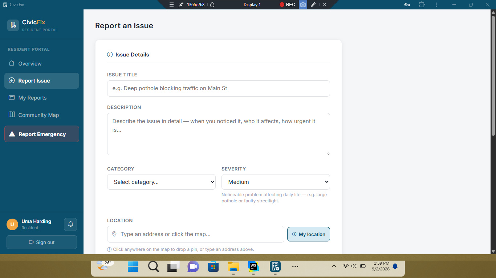
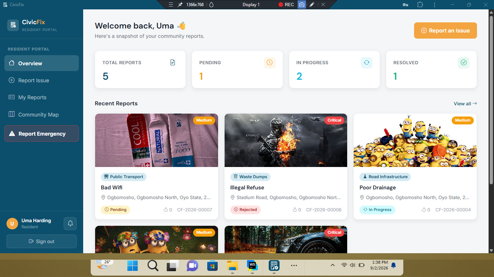
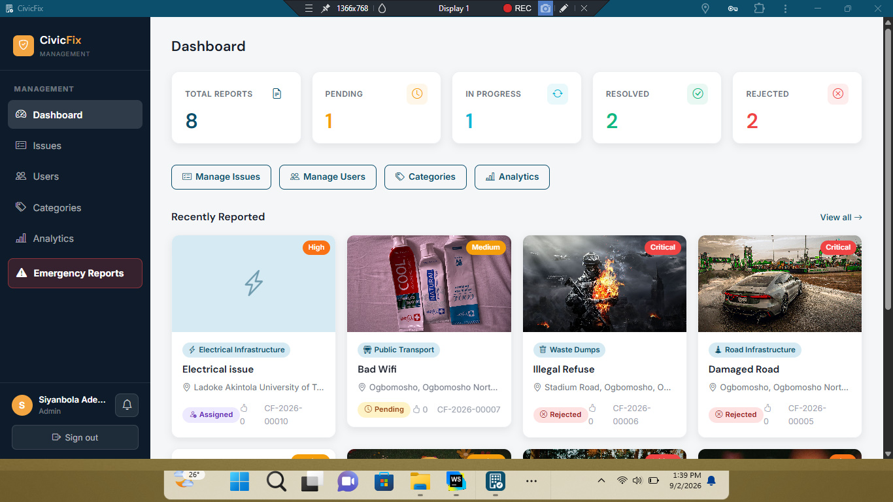
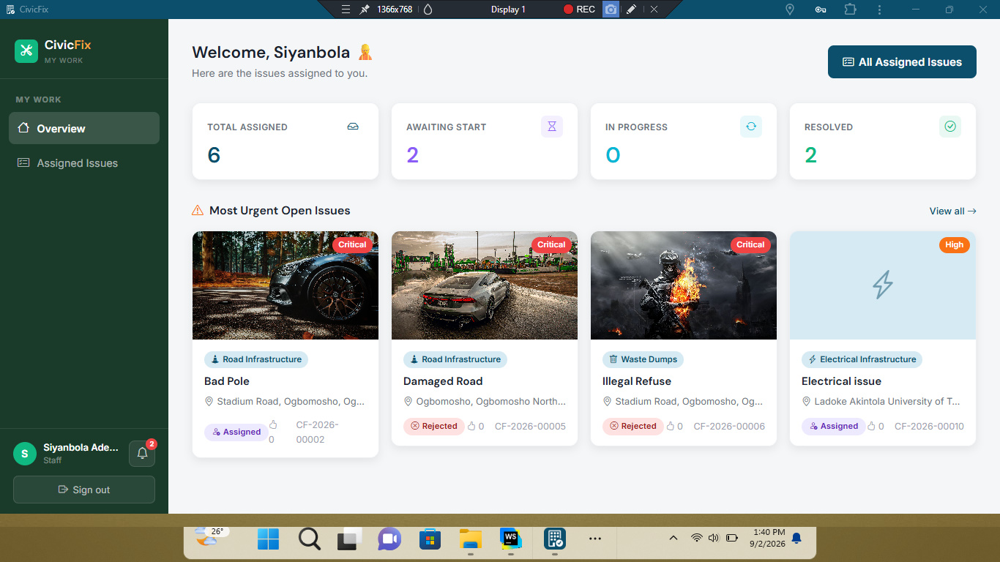
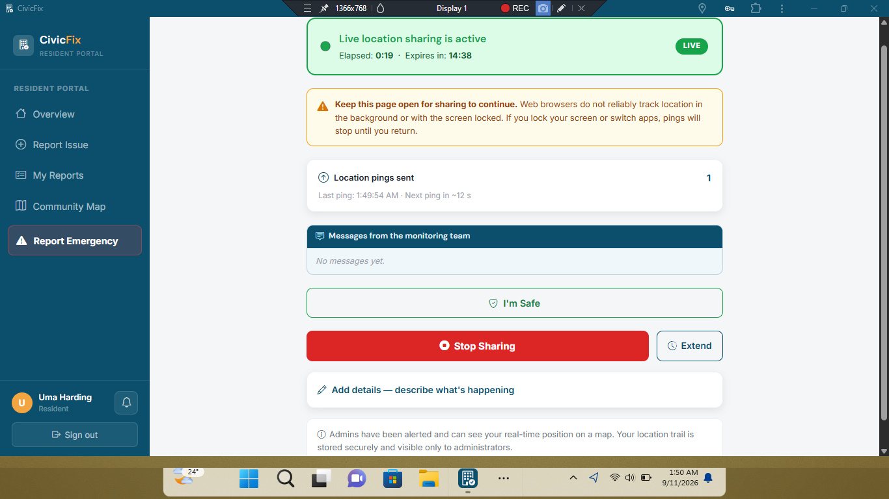
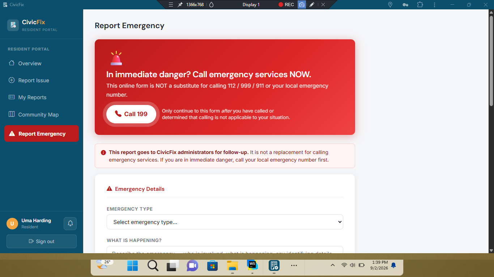

# 🏘️ CivicFix

### Smart Community Problem/Issue & Emergency Reporting and Resolution Platform

CivicFix is a full-stack web application designed to help communities report, manage, and track public infrastructure and environmental problems.

Residents can report issues such as damaged roads, broken streetlights, flooding, illegal waste disposal, and other community concerns. Administrators can review and assign issues to staff members, while staff can provide progress updates and resolution evidence. CivicFix also provides private emergency reporting and live location sharing for situations where a resident's personal safety may be at risk.

🌐 **Live Application:** [Visit CivicFix](https://sjr-civicfix.vercel.app/)  
💻 **Backend Repository:** [CivicFix Backend](https://github.com/ShimboJr/CivicFix-Backend)

---

## 🌍 The Problem

Communities often lack a centralized and transparent system for reporting public problems and tracking their resolution. As a result, issues such as potholes, damaged infrastructure, poor drainage, and waste disposal problems may go unreported or unresolved for long periods.

## 💡 The Solution

CivicFix connects **residents, administrators, and staff** through a structured issue-resolution workflow:

```text
Resident
   ↓
Report an Issue
   ↓
Administrator Review
   ↓
Staff Assignment
   ↓
Progress Updates
   ↓
Resolution Evidence
   ↓
Issue Resolved
```

---

## ✨ Key Features

### 👤 Residents

- Create and manage an account
- Report community issues with location and media
- Track submitted reports
- Browse, search, and filter community issues
- Upvote issues affecting the community
- Receive notifications and status updates
- Detect potentially nearby or duplicate issues
- Submit private emergency reports
- Share live location during an active personal-safety emergency
- Receive silent safety messages from administrators
- Send an "I'm Safe" confirmation without automatically stopping tracking

### 👨‍💼 Administrators

- Manage all community reports
- Assign issues to staff members
- Manage users and user roles
- Manage issue categories
- Monitor staff workload
- View platform statistics and analytics
- Perform bulk issue management
- Manage emergency reports

### 🧑‍🔧 Staff

- View assigned issues
- Update issue progress
- Manage issues through the resolution workflow
- Upload resolution evidence

---

## 🚀 Advanced Features

- 🔐 JWT Authentication
- 👥 Role-Based Access Control
- 📍 Location-Based Issue Reporting
- 🔎 Nearby/Duplicate Issue Detection
- 👍 Community Issue Upvoting
- 💬 Issue Comments
- 📊 Administrative Analytics
- 🔔 In-App Notifications
- 📱 Web Push Notifications
- ☁️ Cloudinary Media Storage
- 📋 Issue Status Audit Logs
- 🔄 Bulk Issue Management
- 📈 Staff Workload Monitoring
- 🚨 Private Emergency Reporting
- 🛡️ Login Rate Limiting and Account Protection
- 🔑 Secure Password Reset
- 📍 Live Location Sharing for Personal Safety
- 🗺️ Real-Time GPS Location Trail and Movement History
- 💬 Silent Admin-to-Resident Emergency Messaging
- 🛡️ "I'm Safe" Confirmation Without Automatic Tracking Termination

---

## 📍 Live Location Sharing

CivicFix includes a dedicated live location sharing feature for personal-safety emergencies.

When a resident activates live location sharing:

1. A private `Live Location SOS` emergency report is automatically created.
2. Administrators are immediately alerted through the existing emergency notification pipeline.
3. The resident's current GPS location is continuously updated during the session.
4. A location trail is maintained so administrators can review movement history.
5. The session has a defined expiry time and can also be explicitly ended by the resident or an administrator.
6. Administrators can send silent in-app messages to the resident without triggering sound, vibration, or OS-level notification banners.
7. The resident can tap **I'm Safe** to notify administrators while location tracking continues.

This feature is designed around privacy and safety: live location data is not publicly listed, and the resident's safe confirmation does not automatically terminate tracking.

---

## 🛠️ Technology Stack

### Backend

- Node.js
- Express.js
- MongoDB
- Mongoose

### Security & Authentication

- JSON Web Tokens (JWT)
- Bcrypt
- Helmet
- Express Rate Limit
- Input Validation

### Additional Services

- Cloudinary
- Nodemailer
- Web Push API

---

## 📸 Application Screenshots

### 🏠 Homepage

The landing page introduces CivicFix and provides quick access to issue reporting and community issue browsing.



---

### 🌍 Community Issues

Residents and visitors can browse publicly reported community issues, search for specific problems, and filter reports by category or status.



---

### 📝 Report an Issue

Authenticated residents can submit detailed reports by providing an issue title, description, category, severity, and location.



---

### 👤 Resident Dashboard

Residents can monitor their submitted reports and track the status of ongoing and resolved issues.



---

### 👨‍💼 Administrator Dashboard

Administrators have access to platform-wide statistics, issue management tools, user management, categories, analytics, and emergency reports.



---

### 🧑‍🔧 Staff Dashboard

Staff members can view assigned issues, prioritize urgent reports, and manage their workload.



---

### 📍 Live Location Sharing

During a personal-safety emergency, residents can activate live location sharing so authorized administrators can monitor their current position and movement history.



---

### 🚨 Emergency Reporting

CivicFix includes a dedicated private emergency reporting system that prominently encourages users to contact emergency services when they are in immediate danger.



---

## ⚙️ Installation and Setup

### 1. Clone the Repository

```bash
git clone https://github.com/ShimboJr/CivicFix-Backend.git
```

### 2. Navigate to the Project Directory

```bash
cd CivicFix-Backend
```

### 3. Install Dependencies

```bash
npm install
```

### 4. Configure Environment Variables

Create a `.env` file in the project root and configure the required environment variables.

Example:

```env
PORT=5000
MONGO_URI=your_mongodb_connection_string
JWT_SECRET=your_jwt_secret
CLIENT_URL=http://localhost:5173
```

Additional environment variables may be required for services such as Cloudinary, email delivery, and web push notifications.

> ⚠️ Never commit your `.env` file or expose secret credentials publicly.

### 5. Start the Development Server

Depending on the scripts configured in `package.json`, run:

```bash
nodemon
```

or:

```bash
npm run dev
```

or:

```bash
npm start
```

---

## 🔌 API Documentation

CivicFix provides a RESTful API for authentication, issue management, notifications, administrative operations, staff workflows, media uploads, emergency reporting, and live location sharing.

For detailed endpoint-by-endpoint documentation, see:

```text
docs/API_DOCUMENTATION.md
```

---

## 👥 User Roles

| Role | Description |
|---|---|
| 👤 **Resident** | Reports and tracks community issues |
| 🧑‍🔧 **Staff** | Handles and updates assigned issues |
| 👨‍💼 **Administrator** | Manages users, issues, staff, and platform operations |

---

## 🔄 Issue Resolution Lifecycle

```text
Pending
   ↓
Under Review
   ↓
Assigned
   ↓
In Progress
   ↓
Resolved
```

An issue may also be marked as:

```text
Rejected
```

---

## 🚀 Deployment

The CivicFix frontend is deployed on Vercel and can be accessed online.

🌐 [Open the CivicFix Live Application](https://sjr-civicfix.vercel.app/)

For backend deployment, ensure that all required production environment variables are configured on your hosting platform.

Typical production configuration includes:

```env
NODE_ENV=production
MONGO_URI=your_production_mongodb_uri
JWT_SECRET=your_secure_jwt_secret
CLIENT_URL=https://sjr-civicfix.vercel.app
```

---

## 🎯 Project Objectives

CivicFix was developed to:

- Provide a centralized platform for reporting community problems.
- Improve communication between residents and authorized personnel.
- Increase transparency in the issue-resolution process.
- Enable residents to track reports from submission to resolution.
- Help administrators prioritize and organize community issues.
- Improve staff coordination and workload management.
- Encourage community participation through shared reports and upvotes.

---

## 🔮 Future Improvements

Potential future enhancements include:

- AI-assisted issue categorization
- Native mobile applications with deeper background location support
- Government and emergency service integrations
- SMS notifications
- Multi-language support

---

## 👨‍💻 Author

**Siyanbola Adeola Olaoluwa**

Developed as a **Level 3 Web Development Completion Project**.

---

## 📄 License

This project is currently intended for **educational and portfolio purposes**.

---

⭐ If you find this project interesting, consider giving the repository a star!
